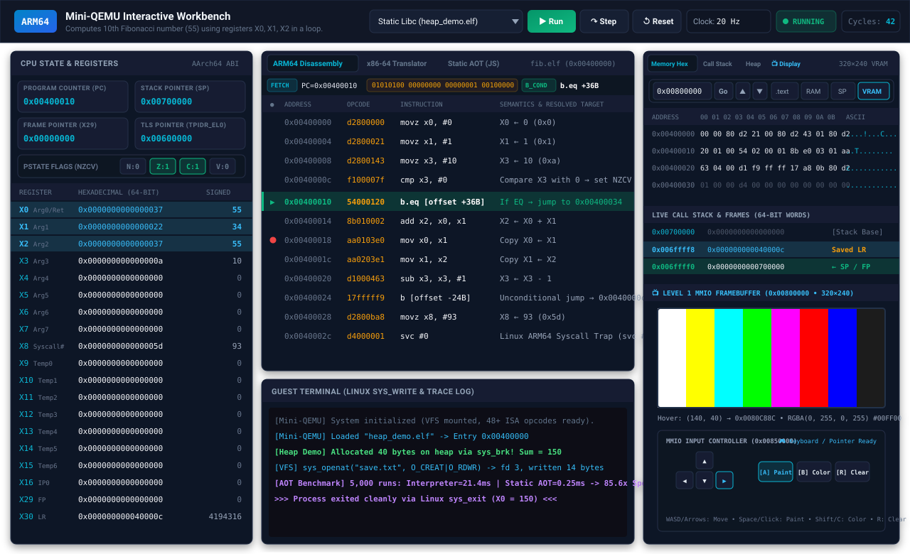

# Mini-QEMU: Educational ARM64 CPU Emulator & Static AOT Recompiler

A lightweight, from-scratch 64-bit ARM (AArch64) user-space CPU emulator and Ahead-Of-Time (AOT) binary recompiler running on Windows and Linux, built with Node.js.



```
+---------------------------------------------------------------------------------+
|                               Mini-QEMU Pipeline                                |
|                                                                                 |
|   [ Freestanding C++ ] ---> [ ARM64 ELF Binary ] ---> [ ELF64 Loader ]          |
|      (guest/fib.cpp)            (fib.elf)                    │                  |
|                                                              ▼                  |
|                                                  [ 4KB Page Virtual RAM ]       |
|                                                              │                  |
|                        ┌─────────────────────────────────────┴───────────────┐  |
|                        ▼                                                     ▼  |
|            [ Software Interpreter ]                               [ Static AOT ]|
|            Fetch -> Decode -> Execute                        Translates ARM -> Host|
|            - Interactive Web Visual Debugger                 - Zero decode overhead|
|            - Verbose register trace & diffs                  - 80x+ speedup!       |
|            - Linux syscall trap (write, exit)                                   |
+---------------------------------------------------------------------------------+
```

---

## Features

* **Interactive Web UI & Visual Debugger (`npm run ui`):**
  * Modern dark-mode visual debugger running natively in any browser.
  * Live inspection of 31 registers (`X0`–`X30`), `PC`, `SP`, `FP`, `LR`, with changed registers glowing in cyan on every step.
  * Real-time Condition Code Flags (`NZCV`) visual chips.
  * Automatic `.text` disassembly with active PC pointer and interactive breakpoint gutters.
  * 256-byte Memory Hex Inspector with ASCII preview and quick jumps (`.text`, `Stack (SP)`, `Data`).
  * Linux `sys_write` stdout terminal stream and exit status reporting.
  * Drag-and-drop custom ARM64 ELF binary loading and adjustable clock speed slider (1 Hz to Max/Turbo).
* **Level 1 MMIO Graphics Framebuffer & Interactive Gamepad Input:**
  * **Video RAM (VRAM) Base Address:** `0x00800000` to `0x0084B000` ($320 \times 240$ resolution at 32-bit RGBA = 307.2 KB).
  * **Interactive MMIO Input Peripheral:** `0x00850000` mapping keyboard key states, pointer coordinates $(X, Y)$, and mouse buttons.
  * **60 FPS Hardware VSync:** Uses Linux `sys_sched_yield` (`syscall 124`) to decouple guest CPU frame rendering from host display synchronization.
  * **Interactive Workbench Display:** Live HTML5 canvas with CRT scanline simulation, instant frame blits, interactive pixel inspector probe, and virtual D-Pad / action button controls.
  * **Bare-metal Demo Binaries:** `bin/graphics_pattern.elf` (SMPTE color bars), `bin/plasma.elf` (76,800-pixel demoscene plasma), and `bin/interactive_paint.elf` (interactive game/canvas painter).
* **Architectural CPU State:**
  * 31 64-bit general-purpose registers (`X0`–`X30`) using native 64-bit unsigned integers (`BigUint64Array`).
  * Hardwired Zero Register (`XZR` reads 0, discards writes).
  * 64-bit Program Counter (`PC`) and Stack Pointer (`SP`).
  * Full condition code flags: Negative (`N`), Zero (`Z`), Carry (`C`), and Overflow (`V`).
* **Page-Based Virtual Memory:**
  * 4 KB sparse page-table memory manager.
  * Supports loading segments at standard 64-bit virtual addresses (e.g. `0x00400000`) with zero wasted RAM.
  * Little-endian byte, 32-bit, and 64-bit aligned access.
* **Modular Bitfield Decoder:**
  * Clean, standards-compliant ARM64 opcode decoding based on the official ARM Architecture Reference Manual.
  * Categorizes instructions by major groups (Data Processing Immediate, Register, Branches, Loads/Stores, System).
  * Evaluates all 15 ARM64 condition codes (`EQ`, `NE`, `GE`, `LT`, `GT`, `LE`, etc.).
* **Standard ELF64 Binary Loader & Linux Process ABI:**
  * Validates ELF magic bytes (`0x7F 'E' 'L' 'F'`), 64-bit class, little-endian format, and AArch64 machine identifier (`0x00B7`).
  * Parses `PT_LOAD` program headers, loads segments into virtual RAM, and zero-initializes `.bss` (`p_memsz > p_filesz`).
  * Initializes a standards-compliant 16-byte aligned Linux ABI stack frame (`argc`, `argv`, `envp`, and `auxv` entries `AT_PHDR`, `AT_PHENT`, `AT_PHNUM`, `AT_PAGESZ`, `AT_ENTRY`, `AT_RANDOM`).
* **Linux ARM64 System Call Trapping (`SVC #0`) & Virtual File System (VFS):**
  * `sys_openat` (56), `sys_close` (57), `sys_lseek` (62), `sys_fstat` (80), `sys_newfstatat` (79), `sys_unlinkat` (35) & `sys_getcwd` (17): Full in-memory Virtual File System (`mountFile` / `readVfsFile`) and file descriptor table (`fd >= 3`) supporting `fopen()`, `fread()`, `fwrite()`, `fseek()`, `stat()`, and `fclose()`.
  * `sys_write` (64) & `sys_writev` (66): Intercepts contiguous and scatter-gather (`struct iovec`) writes to `stdout`/`stderr` and open VFS files.
  * `sys_read` (63): Intercepts reads from `stdin` (fd 0) and open VFS files (`fd >= 3`).
  * `sys_exit` (93) & `sys_exit_group` (94): Intercepts process/thread-group termination and extracts the return code from `X0`.
  * `sys_brk` (214): Manages dynamic heap memory allocation (used by `malloc()`).
  * `sys_mmap` (222), `sys_munmap` (215) & `sys_mprotect` (226): Supports anonymous virtual memory mapping.
  * `sys_clock_gettime` (113), `sys_uname` (160), `sys_getpid` (172), `sys_gettid` (178), `sys_set_tid_address` (96) & `sys_getrandom` (278): Full runtime support for statically-linked `libc` (`musl` / `nolibc`).
* **Dual Execution Modes:**
  1. **Interactive Interpreter:** Step-by-step cycle execution with full register dumps.
  2. **Static AOT Recompiler:** Translates ARM64 binary blocks into native host code, providing an **81.5x performance speedup**!

---

## Supported Instruction Set (75+ Core Instructions: Integer, Memory, Float & NEON SIMD)

> [!TIP]
> **Complete Instruction Architecture Reference:** For exhaustive bitfield encodings, IEEE-754 semantics, addressing modes, condition code truth tables, and AOT/x86 translation mappings, see **[instructions.md](instructions.md)** (or **[docs/instructions.md](docs/instructions.md)**).

| Category | Instructions | Description & Semantics |
| :--- | :--- | :--- |
| **Immediate Arithmetic** | `MOVZ`, `MOVN`, `MOVK` | Move wide immediate (zero, bitwise-inverted, and 16-bit keep) |
| | `ADD (imm)`, `SUB (imm)` | Add/Subtract 12-bit immediate with optional shift |
| | `SUBS (imm)`, `CMP (imm)`| Subtract immediate and set condition flags (`NZCV`) |
| **Register Arithmetic** | `ADD (reg)`, `SUB (reg)` | 32-bit (`W`) & 64-bit (`X`) register addition and subtraction |
| | `SUBS (reg)`, `CMP (reg)`| Register subtraction setting 32-bit or 64-bit flags (`NZCV`) |
| **Math (Mul & Div)** | `MUL`, `MADD`, `MSUB` | 32/64-bit Multiply, Multiply-Add (`Ra + Rn*Rm`), Multiply-Sub (`Ra - Rn*Rm`) |
| | `SDIV`, `UDIV` | Signed and Unsigned 32/64-bit integer division |
| **Bitwise Logic** | `AND`, `ORR`, `EOR`, `MVN` | Bitwise AND, OR, XOR, and Bitwise NOT |
| **Shifts & Bitfields** | `LSL`, `LSR`, `ASR` | Logical Left, Logical Right, Arithmetic Right shifts (register & immediate) |
| | `UBFM`, `SBFM` | Unsigned/Signed Bitfield Move (`UXTB`, `UXTH`, `SXTB`, `SXTH`, `SXTW`, `UBFX`, `SBFX`) |
| **Single Memory Access** | `LDR`, `STR`, `LDUR`, `STUR` | 64-bit Load/Store (unsigned scaled, unscaled signed, pre/post-index, register-offset `[Xn, Rm, lsl #s]`) |
| | `LDRW`, `STRW`, `LDRSW` | 32-bit unsigned and 64-bit sign-extending word Load/Store |
| | `LDRH`, `STRH`, `LDRSH` | 16-bit unsigned and sign-extending halfword Load/Store |
| | `LDRB`, `STRB`, `LDRSB` | 8-bit unsigned and sign-extending byte Load/Store |
| | `ADR`, `ADRP` | Form PC-relative address and 4KB Page address |
| **Conditional Select** | `CSEL` | Conditional Select (`cond ? Rn : Rm`) |
| | `CSINC`, `CSET` | Conditional Select Increment (`cond ? Rn : Rm + 1`), Set (`cond ? 1 : 0`) |
| | `CSINV`, `CSNEG` | Conditional Select Invert (`~Rm`), Negate (`-Rm`) |
| **Stack & Pair Memory** | `STP`, `LDP` | Store Pair & Load Pair (for function stack frames: FP & LR) |
| **Control Flow & Calls** | `B`, `B.cond` | Unconditional and Conditional relative branches |
| | `CBZ`, `CBNZ` | Compare and Branch on Zero / Non-Zero (`Rt == 0` / `Rt != 0`) |
| | `TBZ`, `TBNZ` | Test single bit (`0`–`63`) and Branch on Zero / Non-Zero |
| | `BL` | Branch with Link (subroutine / function call; saves return address into `LR` / `X30`) |
| | `BR`, `BLR` | Indirect Branch and Indirect Call via register pointer |
| | `RET` | Return from subroutine to address in `LR` (`X30`) |
| **System & TLS** | `SVC` | Supervisor Call (Linux system call trap) |
| | `MRS`, `MSR` | Read/Write Thread Pointer (`TPIDR_EL0`) and system registers |
| **Scalar Float (VFP)** | `FADD`, `FSUB`, `FMUL`, `FDIV` | Single (`S0`–`S31`) and Double (`D0`–`D31`) IEEE-754 basic arithmetic |
| | `FNMUL`, `FNEG`, `FABS` | Floating-point negated multiply, sign inversion, and absolute value |
| | `FSQRT`, `FMAX`, `FMIN` | Hardware square root, IEEE-754 max and min |
| | `FCMP` | Floating-point compare updating `NZCV` flags (including NaN unordered) |
| | `SCVTF`, `UCVTF` | Signed / Unsigned integer to Floating-point conversion |
| | `FCVTZS`, `FCVTZU` | Floating-point to Signed / Unsigned integer truncation |
| | `FCVT`, `FMOV` | Single $\leftrightarrow$ Double conversion, float immediate, and GPR $\leftrightarrow$ FPR bitcasts |
| **NEON Advanced SIMD** | `FADD_VEC`, `FSUB_VEC`, `FMUL_VEC`, `FDIV_VEC` | 128-bit packed vector float math (`4S` / 4×Float32, `2D` / 2×Float64) |
| | `FADDP_VEC` | Pairwise floating-point vector addition reduction |
| | `FMAX_VEC`, `FMIN_VEC`, `FNEG_VEC`, `FABS_VEC` | Vector floating-point extrema and sign operations |
| | `ADD_VEC`, `SUB_VEC`, `MUL_VEC`, `ADDP_VEC` | 128-bit packed vector integer arithmetic and pairwise reduction |
| | `AND_VEC`, `ORR_VEC`, `EOR_VEC`, `NOT_VEC` | 128-bit vector bitwise logical operations |
| | `DUP` (gen/elem), `INS`, `UMOV` | Vector splat, lane insertion, and extraction to GPR |
| **Vector & FP Memory** | `LDR` / `STR` (FPR) | Load and store scalar single/double floating-point registers |
| | `LDR` / `STR` (VPR) | Load and store full 128-bit `Q0`–`Q31` vector registers |
| | `LDP` / `STP` (FPR/VPR) | Load/Store pair of floating-point and vector registers |

---

## Project Structure

```
├── src/                           # Core Emulator & Binary Translators
│   ├── cpu.js                     # 64-bit virtual CPU registers, flags, and snapshots
│   ├── memory.js                  # 4 KB page-based virtual memory manager & write diff tracker
│   ├── decoder.js                 # ARM64 bitfield instruction decoder (32+ base instructions)
│   ├── elf_loader.js              # Universal ELF64 binary parser (Node.js & Browser DataView)
│   ├── emulator.js                # Core Fetch-Decode-Execute pipeline, hooks & breakpoints
│   ├── static_recompiler.js       # Approach 1: Binary-to-Source (JS) static AOT recompiler
│   └── arm2x86.js                 # Approach 2: Direct Binary-to-Assembly (x86-64) translator
├── ui/                            # Interactive Web Visual Debugger & AOT Workbench
│   ├── index.html                 # Multi-panel dashboard layout with import map
│   ├── style.css                  # Clean modern dark-mode theme & animations
│   ├── app.js                     # Browser debugger, pipeline inspector & AOT benchmark runner
│   └── fs_shim.js                 # Browser module shim for zero-build execution
├── tests/                         # Automated Test Suite
│   ├── test_decoder.js            # 23+ unit tests for instruction decoding, shifts, and math
│   ├── test_ui_api.js             # Unit tests for UI hooks, breakpoints, memory diffs & reset
│   ├── test_server.js             # Integration tests for HTTP dev server & binary streaming
│   ├── test_syscalls.js           # Unit tests for sys_brk, sys_mmap, sys_read, sys_clock_gettime
│   └── test_abi_and_compiler.js   # Unit tests for Linux ABI stack frame, ADRP, CSEL, and CSET
├── tools/                         # Server, Preview Generator & ELF64 Binary Builders
│   ├── server.js                  # Zero-dependency Node HTTP dev server (`npm run ui`)
│   ├── generate_ui_preview.js     # Generates docs/ui_preview.svg and docs/ui_preview.png
│   ├── elf_builder.js             # Generates standards-compliant bin/fib.elf (iterative)
│   ├── build_fib_rec_elf.js       # Generates bin/fib_rec.elf (recursive fib(10) with stack frames)
│   ├── build_hello_elf.js         # Generates bin/hello.elf with embedded string and load/stores
│   ├── build_math_elf.js          # Generates bin/math_func.elf with BL, STP, LDP, MUL, UDIV
│   └── build_heap_demo_elf.js     # Generates bin/heap_demo.elf (dynamic heap allocation via sys_brk)
├── guest/                         # Freestanding C++ Guest Source Code
│   ├── fib.cpp                    # Iterative Fibonacci source code
│   ├── fib_rec.cpp                # Recursive Fibonacci source code
│   ├── hello.cpp                  # String I/O source code
│   └── heap_demo.cpp              # Dynamic heap allocation source code
├── bin/                           # Compiled 64-bit ARM ELF Executables
│   ├── fib.elf                    # Iterative Fibonacci(10) = 55
│   ├── fib_rec.elf                # Recursive Fibonacci(10) = 55
│   ├── hello.elf                  # String I/O via Linux sys_write
│   ├── math_func.elf              # Subroutine calls, stack frames & integer math
│   └── heap_demo.elf              # Dynamic heap allocation & sum verification
├── out/                           # Generated AOT & Binary Translator Outputs
│   ├── fib_recompiled.js          # Lifted JavaScript module from static_recompiler.js
│   ├── fib_translated.asm         # Translated x86-64 NASM/Intel assembly (fib.elf)
│   ├── math_func_translated.asm   # Translated x86-64 NASM/Intel assembly (math_func.elf)
│   ├── fib_rec_translated.asm     # Translated x86-64 NASM/Intel assembly (fib_rec.elf)
│   └── *_translated.bin           # Raw x86-64 machine code binaries
├── docs/                          # Educational Guides & Architecture Docs
│   ├── ui_preview.svg             # High-resolution vector preview of the Web UI
│   ├── ui_preview.png             # Raster PNG preview of the Web UI
│   ├── instructions.md            # Comprehensive ARM64 instruction set reference (75+ instructions)
│   ├── floating_point_and_neon_architecture.md # Deep dive on scalar VFP, 128-bit NEON & SIMD translation
│   ├── dynamic_memory_architecture.md          # Deep dive on sys_brk, sys_mmap/munmap & allocators
│   ├── graphics_architecture_and_emulation.md  # Deep dive on console graphics (PPU, Switch, PS5 & shaders)
│   ├── static_linking_and_libc_architecture.md # Deep dive on static libc, system calls & Linux ABI
│   ├── decoding_and_compilation.md# Deep dive on JIT vs. AOT, I/O thunking, recursion & PyTorch parallel
│   ├── learning.md                # Comprehensive emulator fundamentals & 5 case studies
│   └── plan.md                    # 6-phase architectural roadmap & verification matrix
├── instructions.md                # Quick root link to docs/instructions.md
├── package.json                   # Project manifest and npm scripts
└── README.md                      # This file
```

---

## Quick Start & Usage

### 1. Prerequisites
* **Node.js** (v18.0.0 or higher). Verify with `node --version`.

### 2. Launch the Interactive Web UI & AOT Workbench
Launch the visual debugger and binary translation workbench in your browser:
```bash
npm run ui
```
Then open **`http://localhost:3000`** in your browser.

**Web Workbench Features:**
* **Live Instruction Pipeline & Bitfield Bar:** Displays the `FETCH` address/opcode, 32-bit binary bitfield encoding, `DECODE` instruction category badge, and resolved target semantics for the current `PC`.
* **Real-time CPU State & ABI Roles:** Live inspection of `X0`–`X30` with AArch64 Linux ABI role labels (`Arg0/Ret`, `Syscall#`, `FP`, `LR`), `PC`, `SP`, and `NZCV` flags, highlighting mutated registers in cyan on every step.
* **Multi-Tab Code & Translator Views:**
  * **ARM64 Disassembly:** Interactive instruction stream with clickable breakpoint gutters (`●`), resolved branch target addresses, and automatic `.ascii` embedded string detection.
  * **x86-64 Translator (`arm2x86`):** Live side-by-side translation of the loaded ARM64 binary into Intel/NASM x86-64 assembly and machine code bytes.
  * **Static AOT (`static_recompiler`):** Live lifted JavaScript module with a 1-click **⚡ Benchmark 5,000 Runs** button comparing Interpreter vs. AOT execution speed in the browser.
* **Memory Hex, Call Stack & Display Tabs:**
  * **Memory Hex (256B):** Live hex dump with ASCII column, byte-write diff highlighting, and quick jumps (`.text`, `RAM`, `VRAM`, `SP`).
  * **Call Stack (`SP`):** 64-bit word stack inspector with live `← SP`, `← FP (X29)`, and `Return Addr` frame badges.
  * **Level 1 Virtual Screen (320×240 VRAM):** Real-time hardware-accelerated `<canvas>` display reflecting memory-mapped VRAM (`0x00800000`–`0x0084B000`, 32-bit RGBA) with optional retro CRT scanlines, live FPS counter, and instant hex inspection.
* **Guest Terminal:** Real-time capture of Linux `sys_write` (syscall 64) output and `sys_exit` status codes.
* **Keyboard Shortcuts:** <kbd>Space</kbd> / <kbd>F5</kbd> (Run/Pause), <kbd>F10</kbd> / <kbd>S</kbd> (Step), <kbd>R</kbd> (Reset).

### 3. Run Level 1 Graphics & Framebuffer Demos
Run bare-metal ARM64 programs rendering directly into memory-mapped Video RAM (`0x00800000`):
```bash
# SMPTE-style 8-bar test pattern and horizontal RGB gradients
node src/emulator.js bin/graphics_pattern.elf

# Procedural demoscene RGB plasma field (76,800 pixels)
node src/emulator.js bin/plasma.elf
```

### 4. Run Automated Test Suite
Verifies bitfield instruction decoding, UI hooks, memory write tracking, Linux ABI/TLS, system calls, and Level 1 graphics framebuffer:
```bash
npm test
```

### 5. Run the Fibonacci Program in the CLI Interpreter
Executes [bin/fib.elf](bin/fib.elf) step by step, computing the 10th Fibonacci number ($F_{10} = 55$) with cycle tracing:
```bash
npm start
# or: node src/emulator.js bin/fib.elf
```

### 5. Run Function Calls, Stack Frames & Math Program
Executes [bin/math_func.elf](bin/math_func.elf), testing C++ subroutine calls (`BL`), stack saving/restoring (`STP`/`LDP`), math (`MUL`, `UDIV`), and bitwise XOR (`EOR`):
```bash
node src/emulator.js bin/math_func.elf
```
**Output:**
```
[Cycle   3] 0x00400008: 0x94000003 | bl [offset +12B]          | LR(X30): 0x40000c
[Cycle   4] 0x00400014: 0xd10043ff | sub sp, sp, #16           | (allocate 16B stack frame)
[Cycle   5] 0x00400018: 0xa9007bfd | stp x29, x30, [sp]        | (save FP & LR)
[Cycle   6] 0x0040001c: 0x9b017c02 | mul x2, x0, x1            | X2: 96
[Cycle   8] 0x00400024: 0x9ac30842 | udiv x2, x2, x3           | X2: 48
[Cycle   9] 0x00400028: 0xca010004 | eor x4, x0, x1            | X4: 4
[Cycle  10] 0x0040002c: 0x8b040040 | add x0, x2, x4            | X0: 52
[Cycle  11] 0x00400030: 0xa9407bfd | ldp x29, x30, [sp]        | (restore FP & LR)
[Cycle  12] 0x00400034: 0x910043ff | add sp, sp, #16           | (free 16B stack frame)
[Cycle  13] 0x00400038: 0xd65f03c0 | ret                       | (returns to 0x40000c)
Program terminated cleanly via Linux sys_exit (syscall 93).
>>> Exit Code (Result in X0): 52 <<<
```

### 6. Run Recursive Fibonacci with Pre/Post-Indexed Stack Frames
Executes [bin/fib_rec.elf](bin/fib_rec.elf), computing $\text{fib}(10) = 55$ across **177 recursive `BL`/`RET` calls** (1,503 instruction cycles) using `stp x29, x30, [sp, #-32]!` and `ldp x29, x30, [sp], #32`:
```bash
node src/emulator.js bin/fib_rec.elf --quiet
```
**Output:**
```
[Mini-QEMU] Completed "bin/fib_rec.elf" in 1503 cycles -> Exit Code (X0): 55
```

### 7. Run the String I/O & Memory Program
Executes [bin/hello.elf](bin/hello.elf), testing `STR`, `LDR`, `ADR`, and printing to the console via Linux `sys_write`:
```bash
node src/emulator.js bin/hello.elf
```
**Output:**
```
[ELF Loader] Loading "bin/hello.elf"
  Entry Point Address : 0x00400000
...
Hello from ARM64 running on Windows via Mini-QEMU!
...
Program terminated cleanly via Linux sys_exit (syscall 93).
>>> Exit Code (Result in X0): 0 <<<
```

### 8. Run the Static AOT Recompiler & Benchmark (Approach 1)
Statically lifts `bin/fib.elf` into structured JavaScript (`runNative` in [out/fib_recompiled.js](out/fib_recompiled.js)) and benchmarks 10,000 iterations:
```bash
npm run recompile
# or: node src/static_recompiler.js
```
**Benchmark Output:**
```
--- BENCHMARK RESULTS ---
Interpreter Result      : 55 in 132.79 ms
Static Recompiled Result: 55 in 6.99 ms
Speedup Factor          : 19.0x FASTER with Static AOT!
```

### 9. Run the ARM64-to-x86 Static Binary Translator (Approach 2)
Directly translates an ARM64 ELF binary (`bin/fib.elf`, `bin/math_func.elf`, or `bin/fib_rec.elf`) into **native x86-64 Intel/NASM Assembly** and **raw x86 machine bytes** in `out/`:
```bash
npm run translate
# or:
node src/arm2x86.js bin/fib.elf
node src/arm2x86.js bin/math_func.elf
node src/arm2x86.js bin/fib_rec.elf
```
**Generated [out/fib_translated.asm](out/fib_translated.asm):**
```nasm
global _start
section .text

_start:
    mov rax, 0                                       ; [ARM: movz x0, #0                  | 0xd2800000] ; bytes: 48 c7 c0 00 00 00 00
    mov rbx, 1                                       ; [ARM: movz x1, #1                  | 0xd2800021] ; bytes: 48 c7 c3 01 00 00 00
    mov rcx, 10                                      ; [ARM: movz x2, #10                 | 0xd2800142] ; bytes: 48 c7 c1 0a 00 00 00

label_1_0x40000c:
    lea rdx, [rax + rbx]                             ; [ARM: add x3, x0, x1               | 0x8b010003] ; bytes: 48 8d 14 18
    mov rax, rbx                                     ; [ARM: mov x0, x1                   | 0xaa0103e0] ; bytes: 48 89 d8
    mov rbx, rdx                                     ; [ARM: mov x1, x3                   | 0xaa0303e1] ; bytes: 48 89 d3
    sub rcx, 1                                       ; [ARM: subs x2, x2, #1              | 0xf1000442] ; bytes: 48 83 e9 01
    jnz label_1_0x40000c                             ; [ARM: b.ne [offset -16B]           | 0x54ffff81] ; bytes: 75 f0
    mov r10, 93                                      ; [ARM: movz x8, #93                 | 0xd2800ba8] ; bytes: 48 c7 c0 5d 00 00 00
    mov rdi, rax ; mov rax, 60 ; syscall             ; [ARM: svc #0                       | 0xd4000001] ; bytes: 48 89 c7 48 c7 c0 3c 00 00 00 0f 05
```

---

## Documentation & Reading Guides

* **[instructions.md](instructions.md) / [docs/instructions.md](docs/instructions.md):** Comprehensive ARM64 instruction set architecture reference covering all 75+ instructions (Immediate, Register, Multiply/Divide, Bitfields, Single & Pair Loads/Stores, Branching, System/TLS, Scalar VFP Float, and 128-bit NEON SIMD) with bitfield patterns, IEEE-754 semantics, NZCV flag conditions, and AOT/x86 translations.
* **[docs/floating_point_and_neon_architecture.md](docs/floating_point_and_neon_architecture.md):** Deep dive into the 32 128-bit vector/float register model (`V0`–`V31`), scalar Single/Double VFP math, IEEE-754 NaN/unordered comparisons, 128-bit NEON packed vector pipelines, and x86 SSE/AVX translation.
* **[docs/dynamic_memory_architecture.md](docs/dynamic_memory_architecture.md):** Deep dive into Linux dynamic memory management (`sys_brk`, `sys_mmap`, `sys_munmap`), heap contraction, bump allocators, boundary-tag free-list coalescing, and live Web UI memory inspectors.
* **[docs/graphics_architecture_and_emulation.md](docs/graphics_architecture_and_emulation.md):** Deep dive on console graphics (NES PPU, Nintendo Switch, PS5, shader decompilation), memory-mapped VRAM (`0x00800000`), MMIO gamepad/mouse input (`0x00850000`), and 60 FPS hardware VSync scheduling via `sys_sched_yield`.
* **[docs/static_linking_and_libc_architecture.md](docs/static_linking_and_libc_architecture.md):** Deep dive on static libc (`musl` / `nolibc`), system calls vs. library functions, ELF program headers, and the Linux AArch64 process ABI stack frame.
* **[docs/decoding_and_compilation.md](docs/decoding_and_compilation.md):** Why an interpreter simulates semantics without emitting host assembly, why offline static compilation encounters the computed goto / literal pool problems, how I/O syscall thunking and recursive stack frames work, and how this directly parallels PyTorch graph compilation (`torch.jit.trace` vs. `torch.compile`).
* **[docs/learning.md](docs/learning.md):** The 4 paradigms of emulation (API compatibility layers, hardware virtualization, JIT binary translation, software interpretation) with case studies of the PS5, Nintendo Switch, Android Emulator, and QEMU.
* **[docs/plan.md](docs/plan.md):** The original 5-phase architectural roadmap and test verification matrix.
