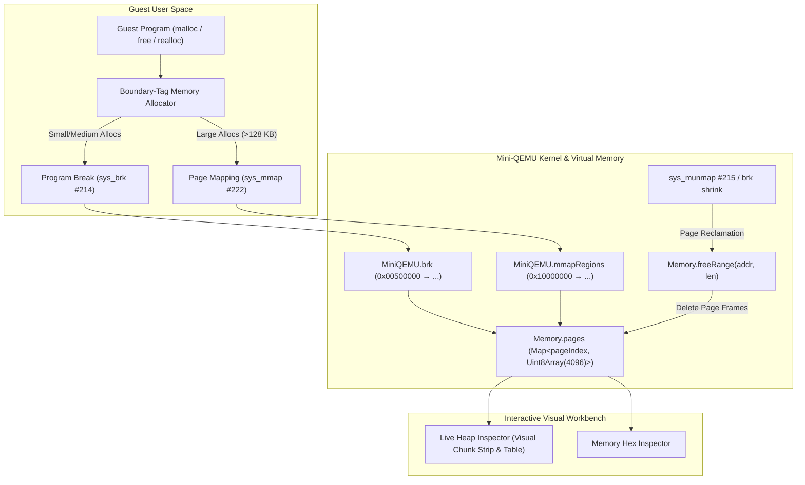

# Dynamic Memory Architecture & Heap Emulation in Mini-QEMU

This document details the **Dynamic Memory Management Subsystem** in **Mini-QEMU**, explaining how Linux ARM64 virtual memory, kernel system calls (`sys_brk`, `sys_mmap`, `sys_munmap`), and boundary-tag heap allocators (`malloc`, `free`, `realloc`, `calloc`) operate under emulation.

---

## 1. Architectural Overview

In low-level systems programming and OS emulation, dynamic memory allocation bridges two distinct layers:
1. **The Kernel Virtual Memory Layer (Paging & Address Space):**
   * Manages physical page frames (4 KB pages in AArch64) and updates the process address space.
   * Exposes raw page-granularity syscalls: `sys_brk` (`#214`), `sys_mmap` (`#222`), and `sys_munmap` (`#215`).
2. **The User-Space Memory Allocator Layer (`libc` / `malloc`):**
   * Operates within the virtual memory ranges mapped by the kernel.
   * Manages variable-sized chunk allocations (e.g. 16 to 1024 bytes) without triggering a kernel context switch for every allocation.
   * Tracks block boundaries, reuses freed chunks ("holes"), and coalesces adjacent free chunks to prevent memory fragmentation.



---

## 2. Linux ARM64 Dynamic Memory System Calls

### 2.1 `sys_brk` (Syscall #214): Program Break Management
* **Query (`X0 = 0`):** Returns the current program break address (`this.brk`).
* **Expansion (`X0 > this.brk`):** Advances the program break. Mini-QEMU dynamically allocates 4 KB pages on-demand as guest instructions read or write to the expanded region.
* **Contraction (`X0 < this.brk`):** Shrinks the heap segment. Mini-QEMU invokes `memory.freeRange(requestedBrk, shrinkLen)`, deleting deallocated physical page frames from resident memory.

### 2.2 `sys_mmap` (Syscall #222): Anonymous Memory Mapping
* Allocates page-aligned virtual memory regions from the mmap area (`0x10000000` upwards).
* Supports `PROT_READ`, `PROT_WRITE`, `MAP_ANONYMOUS`, and `MAP_PRIVATE`.
* Tracks allocated chunks in `MiniQEMU.mmapRegions` map.

### 2.3 `sys_munmap` (Syscall #215): Memory Deallocation
* Reclaims mapped pages back to the host system by deleting pages from `memory.pages`.
* Unregisters regions from `MiniQEMU.mmapRegions`.

---

## 3. Boundary-Tag Allocator Design

Mini-QEMU includes a freestanding C++ dynamic memory allocator ([`guest/dynamic_memory.cpp`](file:///C:/Users/wei.du/WorkAtTPVision/test/emulator/guest/dynamic_memory.cpp)) and compiled binary (`bin/dynamic_memory.elf`).

### 3.1 Chunk Header Layout
Every chunk on the heap is preceded by an 8-byte (64-bit) boundary-tag header:

```
 63                                              1   0
┌───────────────────────────────────────────────┬─────┐
│ Total Chunk Size (Aligned to 16 Bytes)        │ A/F │
└───────────────────────────────────────────────┴─────┘
  * Bit 0 (A/F): 1 = Allocated, 0 = Free
  * Payload Pointer: (Header Address + 8 Bytes)
```

### 3.2 Allocation & Block Splitting (`malloc`)
1. Searches existing chunks between `heapStart` and `current_brk` for the first free block satisfying `chunk_size >= requested_total`.
2. **Splitting:** If `chunk_size >= requested_total + 16`, the block is split into:
   * Allocated chunk of size `requested_total` (`header = requested_total | 1`).
   * Remainder free chunk (`header = (chunk_size - requested_total) | 0`).
3. If no suitable free block exists, `sys_brk` is invoked to expand the heap.

```
Initial Free Hole (80 Bytes):
┌────────────────────────────────────────────────────────┐
│ Header: 80 | 0 (Free)                                  │
└────────────────────────────────────────────────────────┘

After malloc(48) -> Split into 64B Allocated + 16B Free Remainder:
┌───────────────────────────────┬────────────────────────┐
│ Header: 64 | 1 (Allocated)   │ Header: 16 | 0 (Free)  │
├───────────────────────────────┼────────────────────────┤
│ Payload: 56 Bytes             │ Remainder: 8 Bytes     │
└───────────────────────────────┴────────────────────────┘
```

### 3.3 Deallocation & Adjacent Block Coalescing (`free`)
When a chunk is freed, clearing bit 0 (`header &= ~1`) creates a free hole. To eliminate external fragmentation, the allocator performs **adjacent block coalescing**:
1. **Forward Coalescing:** If the chunk immediately following `curr + size` is free, merge the two blocks by adding their sizes: `curr_size += next_size`.
2. **Backward Coalescing:** If the preceding chunk is free, merge backward to create a single contiguous free block.

---

## 4. Live Heap Inspection in Mini-QEMU Workbench

Mini-QEMU provides real-time heap inspection APIs and UI visualizations:

### 4.1 Emulator Heap Metadata APIs
* **`MiniQEMU.getHeapChunks()`**: Traverses boundary-tag headers between `heapStart` and `brk`, parsing each chunk's address, total size, allocation status, and payload address.
* **`MiniQEMU.getHeapStats()`**: Returns comprehensive heap statistics:
  ```json
  {
    "heapStart": 5242880,
    "brk": 5243152,
    "heapSize": 272,
    "pageCount": 4,
    "mappedBytes": 16384,
    "allocatedBytes": 176,
    "freeBytes": 32,
    "allocatedCount": 2,
    "freeCount": 1
  }
  ```

### 4.2 Web Workbench Heap Visualizer (`Heap Allocator` Tab)
* **Visual Heap Strip:** Renders a horizontal segmented block map of the heap.
  * **Cyan Blocks:** Allocated memory with size and payload address.
  * **Slate Blocks:** Free list holes available for reuse.
  * **Click-to-Hex:** Clicking any chunk immediately jumps the **Memory Hex Inspector** to that chunk's header address.
* **Chunk Detail Table:** Lists Chunk Address, Status Badge, Total Size, Payload Size, and Payload Pointer.
